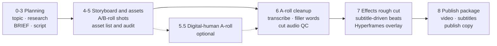

<div align="center">


# Chaojifeng Video Content Creator

A video production skill for AI coding agents, built for Chinese-language videos: topic, script, storyboard, spoken-audio cleanup, effects overlay, subtitles and publish package in one pipeline.

[](LICENSE)
[](SKILL.md)
[](assets/style_library/gallery.html)
[](#requirements-and-limits)

[简体中文](README.md) | English

[Quick start](#quick-start) · [What it does](#what-it-does) · [Workflow](#workflow) · [Effects library](#effects-library) · [Example project](#example-project) · [Requirements and limits](#requirements-and-limits)

</div>

## What it does

Install it into a coding agent that supports Agent Skills, then describe the video you want in plain language. The agent produces files stage by stage, every stage has a gate artifact, and you can enter at any stage.

| Area | Output |
| --- | --- |
| Planning | Topic statement, research list, BRIEF, script, A/B-roll storyboard, asset list and audit |
| Cleanup | Cloud or local transcription, filler-word / repeated-sentence / long-pause cleanup, word-level cuts, subtitle correction, pre-render cut audio QC |
| Effects | 148 HTML/GSAP effects, beat planning from real subtitle timestamps, Hyperframes overlay track with frame-by-frame review |
| Publishing | Final video, SRT/ASS subtitles, publish copy, distribution-risk self-check, screen-recording address masking check |

The skill itself does not include a video generation model, a cover generator or a publishing workbench. Cover images, titles and tags come from capabilities in the host environment; when one is missing, the skill delivers with a fallback and states the gap. Auto mode does not publish anything externally.

Scope: the skill is written for Chinese-language videos. Its instructions, effect names and the filler-word rules in `data/filler_rules.yaml` target Mandarin speech.

## Quick start

```bash
npx skills add mileson/chaojifeng-video-content-creator
```

Then tell your agent:

```text
Use chaojifeng-video-content-creator to plan a 3-minute product intro video: topic statement and research list first, then the script and storyboard.
```

```text
Here is my recorded talking-head video ~/Videos/raw.mp4. Transcribe it, remove filler words and repeated sentences, then plan the effect beats from the subtitle timing.
```

```text
~/Videos/raw.mp4: run auto mode.
```

Auto mode runs, in order: editing and subtitles, title / body / tags, cover images, and a summary of the publish materials.

What you already have decides where to start:

| You have | Start at |
| --- | --- |
| A topic or an idea | Stages 0 to 2: topic, research, BRIEF |
| A script | Stage 4: storyboard and effect binding |
| A recorded talking-head video | Stage 6: transcription and cleanup, then stage 7 for effects |
| A rough cut or final video | Stage 8: subtitles, cover, publish package |

The full entry table is in [SKILL.md](SKILL.md).

Manual install:

```bash
git clone https://github.com/mileson/chaojifeng-video-content-creator.git
```

Put the folder in your agent's skills directory and keep the folder name `chaojifeng-video-content-creator`.

## Workflow



| Stage | What happens | Gate artifact |
| --- | --- | --- |
| 0 Topic | One-sentence topic, audience, platform | `topic-brief.md` |
| 1 Research | Claims, sources, reference videos | `research.md` |
| 2 Strategy | Core message, narrative arc, length, opening | `BRIEF.md` |
| 3 Script | A script that reads aloud well, with its recording status | `SCRIPT.md` |
| 4 Storyboard | A/B-roll shots bound to effect patterns | `STORYBOARD.md`, `BROLL-STYLE.md` |
| 5 Assets | Screen recordings, screenshots, AI images, effect assets | `ASSET-LIST.md`, `ASSET-AUDIT.md` |
| 6 Cleanup | Transcription, filler-word removal, cut audio QC | `transcript.normalized.json`, `subtitle_plan.json`, `edit_decisions.json` |
| 7 Effects rough cut | Subtitle-driven effect beats and overlay track | `EFFECT-BEATS.md`, `broll-overlay/`, `rough-cut/` |
| 8 Publish | Subtitles, final video, publish package, verification | `publish/v00N/` |

Built-in gates:

- Clean first, then add effects: the beat sheet only uses cleaned, real subtitle timestamps.
- Before rendering, every cut is checked for clipped speech, and rendering waits for the cut audio QC by default.
- Evidence, data and product-operation shots use real screen recordings or screenshots.
- Address information in screen recordings is masked on the frames where it actually appears, and the export is checked for both missed and over-applied masks.
- Speech, subtitles and visuals get an automatic distribution-risk self-check that only speaks up when something matches.

## Effects library

`assets/style_library/` holds 148 native effects. Each one is an HTML/GSAP snippet that drops into a Hyperframes overlay track:

| Category | Count |
| --- | --- |
| Beat | 70 |
| Utility | 23 |
| Container | 18 |
| Transition | 13 |
| Outro | 13 |
| Skeleton | 7 |
| Product card | 4 |

It also carries 152 Remotion recipe cards (209 styles) from a pinned snapshot of [video-shotcraft](https://github.com/Vincentwei1021/video-shotcraft). The unified picker `gallery.html` lists 300 recipe cards and 357 styles, searchable by category and keyword.

Open `assets/style_library/gallery.html` in a browser to browse. The page UI, effect names and descriptions are in Chinese; effect ids are in English. Preview pages load GSAP from jsDelivr, so they need a network connection. After adding or changing an effect, run:

```bash
python3 assets/style_library/scripts/build_effects_gallery.py build
python3 assets/style_library/scripts/build_effects_gallery.py refresh
python3 assets/style_library/scripts/build_effects_gallery.py validate
```

Remotion recipe cards are a recipe description plus an upstream preview. Until one is implemented in a Remotion project and verified frame by frame, it is not marked as locally ready.

## Example project

`examples/clean-then-effects/` holds the stage artifacts of a tutorial video of about 43 seconds: topic, research, BRIEF, script and a 12-shot storyboard, plus a word-level transcript, cleanup decisions and the cleaned subtitles for a 15-second talking-head clip.

Reproduce the stage 6 subtitles with any 15-second video (only its duration is read):

```bash
python3 scripts/render_from_transcript.py \
  --video /path/to/any-15s-video.mp4 \
  --transcript examples/clean-then-effects/transcript.json \
  --subtitle-plan examples/clean-then-effects/subtitle_plan.json \
  --work-dir /tmp/clean-then-effects \
  --output /tmp/clean-then-effects/out.mp4 \
  --window 0:15:full \
  --skip-render
```

The generated `/tmp/clean-then-effects/edited.srt` matches `edited.srt` in the example folder.

## Scripts

| Script | Purpose |
| --- | --- |
| `scripts/transcribe_volcengine.py` | Calls Volcengine speech recognition and writes a normalized transcript; `--dry-run` only checks output paths |
| `scripts/normalize_asr_result.py` | Converts a recognition service's JSON into this skill's transcript format |
| `scripts/export_hotwords.py` | Exports recognition hot words from `data/corrections.yaml` |
| `scripts/render_from_transcript.py` | Cuts, builds subtitles and renders from a transcript and `subtitle_plan.json` |
| `scripts/spoken_audio_qc.py` | Checks each cut for clipped speech before rendering; writes `audio-qc.json` and a waveform report |
| `assets/style_library/scripts/build_effects_gallery.py` | Rebuilds previews, refreshes the cache, validates the effects library |

The cut audio QC can run on its own:

```bash
python3 scripts/spoken_audio_qc.py analyze \
  --input raw.mp4 \
  --timeline aroll/edit_decisions.json \
  --transcript aroll/transcript.normalized.json \
  --output-dir checks/spoken-audio-qc
```

It writes `audio-qc.json`, `waveform-report.html` and `review-template.json`. After you listen to the flagged cuts, record your verdicts in `review-template.json` and run it again with `--review review-template.json`. `render_from_transcript.py` runs the same check automatically in standard and aggressive cleanup modes; see [references/cleanup-and-subtitles.md](references/cleanup-and-subtitles.md) for the options.

## Requirements and limits

- Python 3. All scripts use the standard library only. They are tested on macOS with Python 3.12.
- FFmpeg and ffprobe on your `PATH`, for rendering and audio QC.
- Video encoder: `h264_videotoolbox` by default on macOS, `libx264` elsewhere; override with `--video-encoder`.
- Hyperframes (Node.js 22+) renders the overlay track; install it following its documentation. Without it, planning, cleanup and subtitles still work.
- Cloud transcription is optional. The script reads the environment variable `VOLCENGINE_API_KEY` (or `VOLCENGINE_ARK_API_KEY`, `ARK_API_KEY`) and does not load a `.env` file by itself. Fill in a file based on `.env.example` and import it with `set -a; source .env; set +a`. The `vc-url` mode needs a publicly reachable audio URL; the `bigmodel-flash` mode can upload a local file.
- Filler-word, repetition and `X 的话` cleanup rules target Mandarin speech. They live in `data/filler_rules.yaml` and can be edited.
- Cover images, titles / tags and the publishing workbench come from the host environment. [video-publish-workbench](https://github.com/mileson/video-publish-workbench) is a companion option.
- Effect previews depend on GSAP from jsDelivr, and Remotion recipe previews are fetched on demand from upstream remote files.

## Repository layout

```text
SKILL.md                 Entry point: stage map, gates, project contract
references/              Stage-by-stage guides
templates/               Templates for BRIEF, SCRIPT, STORYBOARD and more
data/                    Cleanup rules, hot words, subtitle styles, ASR config, screen-recording cases
scripts/                 Transcription, cut-and-render, audio QC
assets/style_library/    Effects library: registry.json, snippets/, previews/, gallery.html
examples/                Example project
docs/images/             README images
```

## Related projects

- [Hyperframes](https://github.com/heygen-com/hyperframes): renders HTML into video; used for the overlay track.
- [video-shotcraft](https://github.com/Vincentwei1021/video-shotcraft): source of the Remotion recipe cards.
- [video-publish-workbench](https://github.com/mileson/video-publish-workbench): local pre-publish workbench for videos.
- [skills](https://github.com/vercel-labs/skills): the `npx skills` command-line tool.

## Contributing

Issues and pull requests are welcome; see [CONTRIBUTING.md](CONTRIBUTING.md) for the conventions. Report security problems privately as described in [SECURITY.md](SECURITY.md).

## License and acknowledgements

This repository is released under the [MIT License](LICENSE). Some files in the effects library are copied or adapted from examples and components in the Hyperframes catalog, and the Remotion recipe cards come from video-shotcraft; both are Apache-2.0. Attribution and change notes are in [THIRD_PARTY_NOTICES.md](THIRD_PARTY_NOTICES.md). GSAP is loaded from a CDN and is covered by the [GSAP Standard License](https://gsap.com/community/standard-license/).
