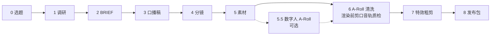
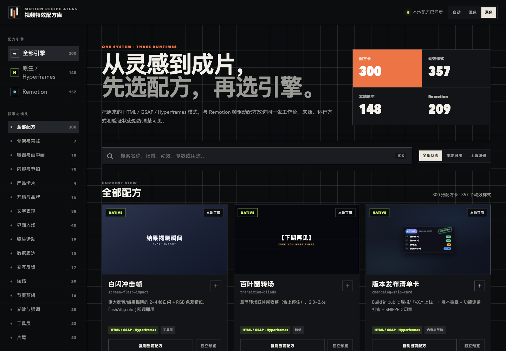

<div align="center">


# Chaojifeng Video Content Creator

中文视频内容创作 Skill：选题、口播稿、分镜、口播清洗、特效叠层、字幕和发布包，一条流水线。

[](LICENSE)
[](SKILL.md)
[](assets/style_library/gallery.html)
[](#要求与边界)

简体中文 | [English](README.en.md)

[快速开始](#快速开始) · [能做什么](#能做什么) · [工作流程](#工作流程) · [特效库](#特效库) · [样例工程](#样例工程) · [要求与边界](#要求与边界)

</div>

## 能做什么

装进支持 Agent Skills 的编码 Agent 后，用自然语言说出视频需求。Agent 按阶段产出文件，每个阶段有门禁产物，可以从任意阶段进入。

| 环节 | 产出 |
| --- | --- |
| 规划 | 选题句、调研清单、BRIEF、口播稿、A/B-Roll 分镜、素材清单与审计 |
| 清洗 | 云端或本地转写、口水词/重复句/长停顿清洗、词级剪切、字幕校正、渲染前剪口音轨质检 |
| 特效 | 148 个 HTML/GSAP 特效，按真实字幕时间戳排节拍，Hyperframes 叠加轨与抽帧目检 |
| 发布 | 成片、SRT/ASS 字幕、发布文案、限流与风控自检、屏录地址遮盖检查 |

Skill 本身不含视频生成模型、封面生成器和发布工作台。封面、标题和标签由宿主环境里的能力完成，缺失时按降级规则交付并写明缺口。自动模式不含对外发布。

## 快速开始

```bash
npx skills add mileson/chaojifeng-video-content-creator
```

装好后直接对 Agent 说：

```text
用 chaojifeng-video-content-creator 帮我做一条 3 分钟的产品介绍视频：先出选题句和调研清单，再写口播稿和分镜。
```

```text
这是录好的口播 ~/Videos/raw.mp4。转写后清掉口水词和重复句，再按字幕时间排特效节拍。
```

```text
~/Videos/raw.mp4 这个视频，走自动模式。
```

自动模式依次完成剪辑与字幕、标题正文标签、封面图片、发布材料汇总。

手里已有的内容决定从哪一步开始：

| 手里有 | 从这里开始 |
| --- | --- |
| 一个选题或想法 | 阶段 0 到 2：选题、调研、BRIEF |
| 口播稿 | 阶段 4：分镜与特效绑定 |
| 录好的口播视频 | 阶段 6：转写与清洗，需要特效再进阶段 7 |
| 粗剪或成片 | 阶段 8：字幕、封面、发布包 |

完整入口表见 [SKILL.md](SKILL.md)。

手动安装：

```bash
git clone https://github.com/mileson/chaojifeng-video-content-creator.git
```

把目录放进 Agent 的 skills 目录，目录名保持 `chaojifeng-video-content-creator`。

## 工作流程



| 阶段 | 做什么 | 门禁产物 |
| --- | --- | --- |
| 0 选题 | 一句话选题、受众、平台 | `topic-brief.md` |
| 1 调研 | 论点、来源、参考视频 | `research.md` |
| 2 策略 | 核心信息、叙事弧、时长、开场 | `BRIEF.md` |
| 3 口播稿 | 可朗读的口播稿，标明口述状态 | `SCRIPT.md` |
| 4 分镜 | A/B-Roll 镜头，绑定特效模式 | `STORYBOARD.md`、`BROLL-STYLE.md` |
| 5 素材 | 屏录、截图、AI 图、特效素材 | `ASSET-LIST.md`、`ASSET-AUDIT.md` |
| 6 清洗 | 转写、去口水词、剪口音轨质检 | `transcript.normalized.json`、`subtitle_plan.json`、`edit_decisions.json` |
| 7 特效粗剪 | 字幕驱动的特效节拍与叠加轨 | `EFFECT-BEATS.md`、`broll-overlay/`、`rough-cut/` |
| 8 发布 | 字幕、成片、发布包与验证 | `publish/v00N/` |

内置的门禁：

- 先清洗再加特效，节拍表只用清洗后的真实字幕时间戳生成。
- 渲染前逐个剪口检查是否切到语音，默认在剪口音轨质检通过后才渲染。
- 证据、数据和产品操作类镜头使用真实屏录或截图。
- 屏录里的地址信息按实际出现的帧遮盖，导出后复核漏遮与误遮。
- 口播、字幕与画面自动做限流与风控风险自检，有命中才提示。

## 特效库

`assets/style_library/` 收录 148 个本地原生特效，每个都是可直接放进 Hyperframes 叠加轨的 HTML/GSAP 片段：

| 类别 | 数量 |
| --- | --- |
| 节拍 | 70 |
| 工具层 | 23 |
| 容器 | 18 |
| 转场 | 13 |
| 片尾 | 13 |
| 骨架 | 7 |
| 产品卡 | 4 |

另有 152 张 Remotion 配方卡（209 个样式），来自 [video-shotcraft](https://github.com/Vincentwei1021/video-shotcraft) 的固定快照。统一挑选页 `gallery.html` 汇总 300 张配方卡、357 个样式，可按类别和关键词检索。



用浏览器打开 `assets/style_library/gallery.html` 即可浏览。预览页从 jsDelivr 加载 GSAP，需要联网。新增或修改特效后运行：

```bash
python3 assets/style_library/scripts/build_effects_gallery.py build
python3 assets/style_library/scripts/build_effects_gallery.py refresh
python3 assets/style_library/scripts/build_effects_gallery.py validate
```

Remotion 配方卡是配方描述加上游预览。在 Remotion 工程里实现并抽帧验证之前，它们不标为本地可用。

## 样例工程

`examples/clean-then-effects/` 是一条约 43 秒教程视频的阶段产物：选题、调研、BRIEF、口播稿、12 镜分镜，以及一段 15 秒口播的词级转写、清洗决策和清洗后的字幕。

用任意一段 15 秒视频（只读取时长）复现阶段 6 的字幕：

```bash
python3 scripts/render_from_transcript.py \
  --video /path/to/any-15s-video.mp4 \
  --transcript examples/clean-then-effects/transcript.json \
  --subtitle-plan examples/clean-then-effects/subtitle_plan.json \
  --work-dir /tmp/clean-then-effects \
  --output /tmp/clean-then-effects/out.mp4 \
  --window 0:15:full \
  --skip-render
```

生成的 `/tmp/clean-then-effects/edited.srt` 与样例目录里的 `edited.srt` 一致。

## 脚本

| 脚本 | 用途 |
| --- | --- |
| `scripts/transcribe_volcengine.py` | 调用火山引擎语音识别并输出标准化转写，`--dry-run` 只检查输出路径 |
| `scripts/normalize_asr_result.py` | 把识别服务返回的 JSON 转成本 Skill 的转写格式 |
| `scripts/export_hotwords.py` | 从 `data/corrections.yaml` 导出识别热词 |
| `scripts/render_from_transcript.py` | 按转写和 `subtitle_plan.json` 剪辑、生成字幕并渲染 |
| `scripts/spoken_audio_qc.py` | 渲染前检查每个剪口是否切到语音，输出 `audio-qc.json` 和波形报告 |
| `assets/style_library/scripts/build_effects_gallery.py` | 重建预览、刷新缓存、校验特效库 |

剪口音轨质检可单独运行：

```bash
python3 scripts/spoken_audio_qc.py analyze \
  --input raw.mp4 \
  --timeline aroll/edit_decisions.json \
  --transcript aroll/transcript.normalized.json \
  --output-dir checks/spoken-audio-qc
```

输出 `audio-qc.json`、`waveform-report.html` 和 `review-template.json`。人工复听标出的剪口后，把结论填进 `review-template.json`，再加上 `--review review-template.json` 重新运行一次。`render_from_transcript.py` 在标准和激进清洗模式下会自动调用这套检查，参数说明见 [references/cleanup-and-subtitles.md](references/cleanup-and-subtitles.md)。

## 要求与边界

- Python 3，所有脚本只用标准库。脚本在 macOS 和 Python 3.12 上测试。
- FFmpeg 与 ffprobe 在 `PATH` 中：渲染和音轨质检需要。
- 视频编码器：macOS 默认 `h264_videotoolbox`，其他系统默认 `libx264`，用 `--video-encoder` 指定。
- Hyperframes（Node.js 22+）用于叠加轨渲染，按其文档安装。没有它时，规划、清洗和字幕仍可完成。
- 云端转写可选。脚本只读取环境变量 `VOLCENGINE_API_KEY`，也可使用 `VOLCENGINE_ARK_API_KEY` 或 `ARK_API_KEY`，不会自动加载 `.env` 文件。可参照 `.env.example` 写好后用 `set -a; source .env; set +a` 导入。`vc-url` 模式需要公网可访问的音频地址，`bigmodel-flash` 模式可直接上传本地文件。
- 口水词、重复句和 `X 的话` 等清洗规则针对中文口播，规则文件是 `data/filler_rules.yaml`，可按需修改。
- 封面图片、标题标签和发布工作台由宿主环境提供，可搭配 [video-publish-workbench](https://github.com/mileson/video-publish-workbench)。
- 特效库预览依赖 jsDelivr 上的 GSAP，Remotion 配方卡的预览视频按需读取上游远程文件。

## 目录结构

```text
SKILL.md                 入口：阶段地图、门禁、工程契约
references/              分阶段操作指南
templates/               BRIEF、SCRIPT、STORYBOARD 等产物模板
data/                    清洗规则、热词、字幕样式、识别服务配置、屏录案例
scripts/                 转写、剪辑渲染、音轨质检
assets/style_library/    特效库：registry.json、snippets/、previews/、gallery.html
examples/                样例工程
docs/images/             README 配图
```

## 相关项目

- [Hyperframes](https://github.com/heygen-com/hyperframes)：HTML 渲染成视频的框架，叠加轨渲染使用。
- [video-shotcraft](https://github.com/Vincentwei1021/video-shotcraft)：Remotion 配方卡的来源。
- [video-publish-workbench](https://github.com/mileson/video-publish-workbench)：本地视频预发布工作台。
- [skills](https://github.com/vercel-labs/skills)：`npx skills` 命令行工具。

## 参与贡献

欢迎提交 Issue 和 Pull Request，约定见 [CONTRIBUTING.md](CONTRIBUTING.md)。安全问题请按 [SECURITY.md](SECURITY.md) 私下报告。

## 许可与致谢

本仓库使用 [MIT 许可](LICENSE)。特效库中部分文件复制或改写自 Hyperframes 官方目录中的示例和组件，Remotion 配方卡来自 video-shotcraft，二者均为 Apache-2.0，署名和改动说明见 [THIRD_PARTY_NOTICES.md](THIRD_PARTY_NOTICES.md)。GSAP 通过 CDN 加载，适用 [GSAP 标准许可](https://gsap.com/community/standard-license/)。
